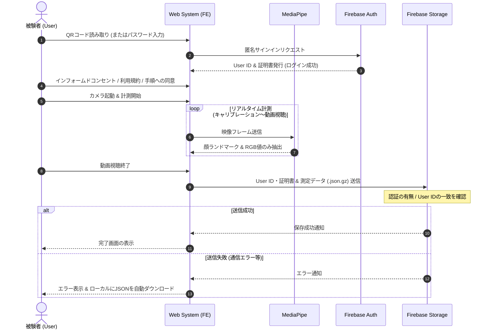

# Data Collect (データ収集システム)

本ディレクトリは、オンライン授業・オンデマンド授業における学習者の集中度を推定するAI・システムの構築を目的とした、リアルタイム計測および学習データ収集用Webアプリケーションです。

## プロジェクト概要

被験者に講義動画およびリラックス動画を視聴してもらい、Webカメラを通じて目や頭部回転角などのランドマーク座標と頬部分のRGB値をリアルタイムで抽出・収集します。カメラの映像自体や顔画像そのものはサーバーに送信・保存せず、抽出されたデータのみを安全に保持・送信する設計となっています。

## 主な機能

1. **リアルタイム顔認識 & キャリブレーション**
   - Google MediaPipe FaceLandmarker を利用したリアルタイムの顔認識。
   - 計測開始直後に **5秒間のキャリブレーション**（正面注視）を実施。
   - 顔が認識できない場合の即時警告ポップアップ表示。

2. **動画再生に連動したデータ計測**
   - **講義動画フェーズ:** 主な集中度データ収集(`class.mp4`)。
   - **リラックス動画フェーズ:** 集中解放時のベースラインデータ収集(`campfire.mp4`)。

3. **データ送信 & フォールバック機能**
   - **Firebase匿名認証:** ランダム発行された識別子（UID）とランダム文字列による匿名化データ管理。
   - **通信保護:** HTTPS通信によりデータの盗聴・改ざんを防止。
   - **ローカルバックアップ:** 送信失敗時は自動的にローカルへJSONファイルをダウンロード保存。

## システムフロー



## 主要ファイル構成

```text
data_collect
│ 
├── README.md
├── LICENSE
├── cors.json                 # Firebase Storage CORS設定
│ 
├── app/
│   ├── api/
│   │   └── content/          # 同意書・利用規約等のMarkdownコンテンツ取得API
│   ├── components/
│   │   └── QrScanner.tsx     # QRコード読み取りコンポーネント (html5-qrcode)
│   ├── hooks/
│   │   ├── useFaceLandmarker.ts  # MediaPipe初期化フック
│   │   ├── useWebcam.ts          # カメラ映像取得フック
│   │   └── useMeasurement.ts     # 計測ロジック・状態管理フック
│   ├── lib/
│   │   ├── firebase.ts       # Firebase初期化・Storageアップロード処理
│   │   ├── landmarks.ts      # 顔ランドマーク抽出インデックス定義
│   │   └── rppg.ts           # 脈拍(rPPG)およびRGB特徴量抽出処理
│   ├── ConcentrationApp.tsx  # 実験用メインコンポーネント（UI・画面遷移・計測連携）
│   ├── layout.tsx            # アプリケーション全体のルートレイアウト
│   ├── page.tsx              # 被験者ログイン・認証ページ (QR / パスワード)
│   ├── types.ts              # 計測データおよび状態の型定義
│   └── globals.css           # グローバルスタイル定義
│ 
├── public/
│   ├── class_long.mp4        # 実験用講義動画（本編）
│   ├── class_demo.mp4        # 講義動画（デモ用）
│   └── campfire.mp4          # 実験用リラックス動画
│ 
└── content/ (またはAPI参照先)
    ├── informed_consent.md   # インフォームドコンセント
    ├── introduction.md       # 実験手順・注意事項
    ├── privacy.md            # プライバシーポリシー
    └── terms.md              # 利用規約
```

## プライバシー&セキュリティ

- **映像データの非保持:** Webカメラの映像データや顔画像自体は外部サーバーに一切送信・保存されません。
- **最小限のデータ収集:** 指定された顔ランドマークの座標データおよび一部のRGB値（脈拍推定等）のみを取得・送信します。
- **匿名性の確保:** Firebaseの匿名認証機能により、ランダムに割り振られるUIDおよび10桁の識別用文字列のみで管理され、個人情報との紐付けは行われません。  
- **通信暗号化:** Firebaseとの通信はすべてHTTPSで暗号化されています。

## 開発環境

- Node.js (v22以上推奨)
- npm / yarn / pnpm

    1. **リポジトリのクローン & パッケージインストール**

    ```text
    git clone <repository-url>
    cd <repository-directory>
    npm install
    ```

    2. **環境変数(`.env.local`)の設定**

    | 変数名 | 必須 | 設定内容・説明 | 取得先 / 設定先 |
    | :--- | :--- | :--- | :--- |
    | NEXT_PUBLIC_FIREBASE_API_KEY | 必須 | Firebase プロジェクトの API キー | Firebase Console (プロジェクト設定) |
    | NEXT_PUBLIC_FIREBASE_AUTH_DOMAIN | 必須 | Firebase Auth の認証ドメイン | Firebase Console (プロジェクト設定) |
    | NEXT_PUBLIC_FIREBASE_PROJECT_ID | 必須 | Firebase プロジェクト ID | Firebase Console (プロジェクト設定) |
    | NEXT_PUBLIC_FIREBASE_STORAGE_BUCKET | 必須 | Cloud Storage のバケット名 | Firebase Console (プロジェクト設定) |
    | NEXT_PUBLIC_FIREBASE_MESSAGING_SENDER_ID | 必須 | Firebase Cloud Messaging の送信者 ID | Firebase Console (プロジェクト設定) |
    | NEXT_PUBLIC_FIREBASE_APP_ID | 必須 | Firebase アプリケーション ID | Firebase Console (プロジェクト設定) |
    | EXPERIMENT_PASSWORD | 任意(※) | パスワード入力画面で使用する実験用認証パスワード | 任意の英数字文字列 |

    ※ 被験者ログイン画面の削除もしくはコメントアウトは各自で行って下さい

    3. **ローカル開発サーバの起動**

    ```text
    npm run dev
    ```

    ブラウザで <http://localhost:3000> にアクセスして動作を確認します。

## 動画について

講義動画は [Gemini Notebook](https://notebook.google.com/) を用いて作成、リラックス動画は [Pexels](https://www.pexels.com/ja-jp/) の素材を使用しました。
