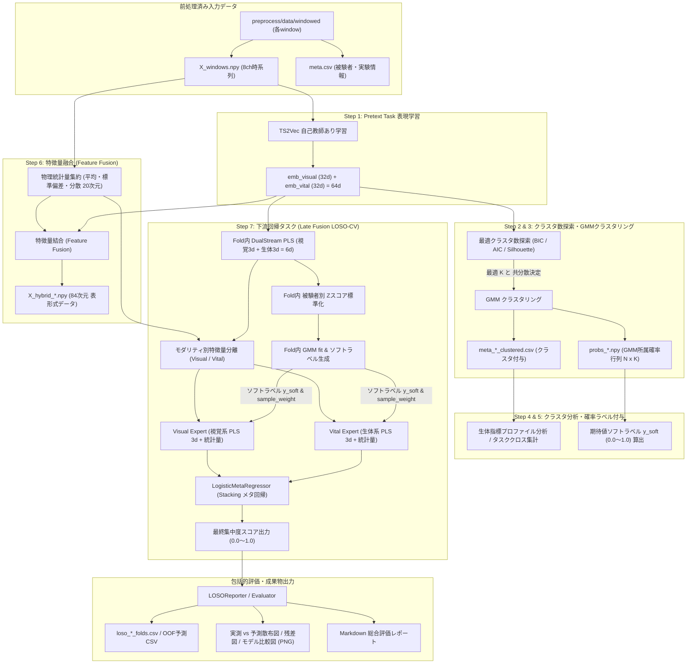

# 学習パイプライン (Learning Pipeline: TS2Vec ➔ GMM ➔ Feature Fusion ➔ Late Fusion LOSO-CV 回帰)

多モーダル時系列データ（RGB カメラ映像由来の顔特徴量 ＋ 脈波 rPPG / 心拍数）を入力とし、自己教師あり表現学習（TS2Vec）、GMM 潜在クラスタリング、期待値ソフトラベリング、特徴量融合を経て、最終的な**集中度連続値推定（Late Fusion 回帰モデル群 ＋ LOSO-CV による完全データリークフリー評価）**を行う機械学習パイプラインです。

---

## プロジェクト概要

前処理パイプライン（`preprocess`）で生成された 8 チャネル時系列データ（瞬目比率 `ear_ratio`、頭部姿勢 `head_pose_*_diff`、視線角 `gaze_*_diff`、脈波 `bvp_selected`、心拍数 `bpm`）を受け取り、教師なし学習によって潜在状態（集中 / リラックス / 移行状態）を特定した上で、最終的な集中度推定モデルを構築します。

本パイプラインは、**「連続値ソフトラベル（期待値集中度スコア $y \in [0.0, 1.0]$）に対する Late Fusion（モダリティ分離アンサンブル）回帰モデル群」**と、未知の被験者に対する汎化性能を厳密に検証する**「LOSO-CV (Leave-One-Subject-Out Cross-Validation: 完全データリークフリー交差検証)」**を採用しています。

---

## 主な機能・パイプラインフロー

> [!NOTE]
> **パイプライン設計と評価の役割分担について**
> Step 2〜6（GMM クラスタリング・分析・ソフトラベル・特徴量融合）はデータセット全体の統計的・物理的性質を把握するための **探索的データ分析 (EDA) / プロファイリング** です。
> 一方で、モデルの真の汎化性能評価は、テスト被験者を完全除外して各 Fold 内で独立処理（PLS 次元削減・被験者別 Z スコア標準化・GMM 推論・Late Fusion 回帰）を閉じて行う **Step 7（完全リークフリー LOSO-CV 回帰評価）** によって厳密に担保されています。




### パイプライン各工程の詳細

| 工程 | モジュール | 入力 | 出力 | 主な処理内容 |
| :--- | :--- | :--- | :--- | :--- |
| **Step 1: 表現学習・PLS・標準化** | `previous_task/` | `X_windows.npy` (8ch) / `emb_*.npy` | `emb_*.npy` (32d), `pls_*_fused_standardized.npy` | Colab (`previous_task.ipynb` Cell 1〜5) で TS2Vec 潜在埋め込み (32d×2) を抽出し、ローカル (`previous_task/`) で PLS エルボー分析・PLS 次元削減・GMM 直前の被験者別 Z スコア標準化を実行。 |
| **Step 2: クラスタ数決定** | `clustering/decision/` | `pls_*_fused_standardized.npy` | `cluster_selection_metrics.png`, `.csv` | $K=2 \sim 10$ および 4 種の共分散タイプ（full, tied, diag, spherical）で GMM を探索し、BIC/AIC/Silhouette で最適 $K$ を自動決定。 |
| **Step 3: GMMクラスタリング** | `clustering/gmm/` | `pls_*_fused_standardized.npy` | `probs_*.npy` ($[N, K]$), `meta_*_clustered.csv` | 決定された $K$ で GMM を学習（Trainのみ fit）。各サンプルの事後所属確率行列 `probs` および推定クラスタを算出・保存。 |
| **Step 4: クラスタ分析** | `clustering/analysis/` | `meta_*_clustered.csv`, `X_windows.npy` | `cluster_profiles.csv`, `cluster_analysis_report.md` | クラスタごとの心拍数 (BPM)、瞬目比率 (EAR)、頭部姿勢・視線移動量分散を集計。実験タスク（講義: 1 / 休憩: 0）とのクロス集計により集中状態を特定。 |
| **Step 5: 確率ラベル算出** | `clustering/probability/` | `probs_*.npy`, 重み $w_k$ | `y_soft_*.npy`, 分布プロット | クラスタ重要度重みベクトルとの内積により、各サンプルの期待値集中度スコア $y_{\text{soft}} \in [0, 1]$ を算出。 |
| **明示的特徴量** | `features/` | `X_windows.npy` (8ch) | 物理統計量 (20次元: EAR, 頭部, 視線, BPM) | 8チャネル時系列から人間が解釈可能な明示的物理統計量を算出・集約。下流タスクの各 Expert 入力として動的結合。 |
| **Step 7: 下流回帰タスク** | `downstream_task/` | `emb_*.npy`, `X_windows.npy`, メタデータ | 学習済み回帰モデル、OOF予測値、評価レポート、プロット | Early Fusion を完全撤廃し、**Late Fusion (Visual Expert + Vital Expert ➔ LogisticMetaRegressor)** 一本による完全データリークフリー回帰学習・推論・包括的評価を実行。 |

---

## 下流タスク（Downstream Task: Late Fusion LOSO-CV 回帰）の設計仕様

### 1. 完全データリークフリー交差検証 (LOSO-CV)

被験者単位で未知テストデータとする **Leave-One-Subject-Out Cross-Validation** を採用し、各 Fold ループ内で以下の順序で処理を完結させます：

1. **DualStream PLS**: テスト被験者1名を除外した Train データのみで PLS を fit し、視覚・生体埋め込みをそれぞれ 3 次元に次元削減（計 6 次元）。
2. **被験者別 Z スコア標準化**: Train 内の各被験者ごとに平均・分散で標準化（テストデータは Train 全体統計量で変換）。
3. **Fold 内 GMM fit**: Train データのみで GMM ($k=2$) を学習し、事後所属確率から期待値ソフトラベル $y \in [0, 1]$ と確信度重みを生成。
4. **モダリティ分離特徴量構築**: PLS 特徴量（6 次元）と明示的物理統計量（20 次元）を Visual 系（視覚 PLS 3d ＋ 視覚統計量）と Vital 系（生体 PLS 3d ＋ 生体統計量）に分離。
5. **Step 7-1: モダリティ別ベースモデル学習 (`base_model/`)**:
   - **Visual Base Models**: 視覚系特徴量（視覚 PLS 3d ＋ 視覚統計量 16d = 19d）のみを入力として、5種の回帰モデル（`random_forest`, `xgboost`, `lightgbm`, `catboost`, `adaboost`）を Early Stopping 付きで学習・評価・保存。
   - **Vital Base Models**: 生体系特徴量（生体 PLS 3d ＋ 生体統計量 4d = 7d）のみを入力として、5種の回帰モデルを Early Stopping 付きで学習・評価・保存。
6. **Step 7-2: メタモデル学習 & 最終推論 (`meta_model/`)**:
   - `config.yaml` の `downstream_task.meta_model.selected_base_models` で指定された Visual / Vital ベースモデルの OOF 予測値を入力として、4種のメタモデル（`logistic_regression`, `ridge`, `lasso`, `elastic_net`）を学習・評価・保存し、最終推論結果を出力。

### 2. 対象モデル群 (Base Model 5種 & Meta Model 4種)

* **Base Models (`downstream_task/base_model/models/`)**:
  * `random_forest` (`RandomForestBaseRegressor`: `warm_start` による検証ロス監視 Early Stopping)
  * `xgboost` (`XGBoostBaseRegressor`: ネイティブ Early Stopping)
  * `lightgbm` (`LightGBMBaseRegressor`: Callback Early Stopping)
  * `catboost` (`CatBoostBaseRegressor`: Pool Early Stopping)
  * `adaboost` (`AdaBoostBaseRegressor`: `staged_predict` による検証ロス監視 Early Stopping)
* **Meta Models (`downstream_task/meta_model/models/`)**:
  * `logistic_regression` (`LogisticMetaRegressorModel`: 重み付きソフトターゲット交差エントロピー最小化)
  * `ridge` (`RidgeMetaRegressorModel`)
  * `lasso` (`LassoMetaRegressorModel`)
  * `elastic_net` (`ElasticNetMetaRegressorModel`)

---

## 主要ファイル構成

```text
learning/
├── config.yaml                   # 学習共通設定ファイル (全パラメータ一元管理)
├── config_loader.py              # YAML 設定ロードモジュール
├── main.py                       # パイプライン全体 CLI エントリーポイント
│
├── previous_task/                # Step 1: 自己教師あり表現学習 (TS2Vec) ➔ PLS ➔ 被験者別 Z スコア標準化
│   ├── __init__.py               # PLS エルボー分析・PLS 特徴量抽出・被験者別標準化 (PreviousTask)
│   ├── pipeline.py               # 前段タスク単体 CLI パイプライン
│   └── previous_task.ipynb       # TS2Vec 学習・潜在埋め込み抽出ノートブック (Google Colab 用: Cell 1〜5)
│
├── clustering/                   # Step 2〜5: クラスタリング・分析・確率ラベリング
│   ├── pipeline.py               # クラスタリング単体パイプライン (ClusteringPipeline)
│   ├── data_loader.py            # 潜在埋め込み・時系列・メタデータ統合ローダー
│   ├── decision/                 # Step 2: 最適クラスタ数探索 (BIC/AIC/Silhouette)
│   ├── gmm/                      # Step 3: GMM 学習・推論・クラスタリング
│   ├── analysis/                 # Step 4: クラスタ生体物理統計分析・物理解釈
│   └── probability/              # Step 5: サンプル別期待値ソフトラベル算出
│
├── features/                     # 明示的物理特徴量モジュール (20次元統計量集約)
│   ├── __init__.py               # 公開 API (compute_explicit_statistics)
│   ├── explicit_stats.py         # 時系列 8ch からの 20次元統計量算出ロジック
│   └── constants.py              # 特徴量列名・定数定義
│
└── downstream_task/              # Step 7: 下流タスク (Base Model ➔ Meta Model 2段階構成)
    ├── __init__.py               # パッケージ初期化・公開API
    ├── pipeline.py               # 2段階統合パイプライン (DownstreamTaskPipeline)
    ├── main.py                   # コマンドライン CLI エントリーポイント
    ├── pls.py                    # DualStream PLS (生体3d + 視覚3d = 6d)
    ├── data_loader.py            # 特徴量ロード・被験者標準化・モダリティ分離処理
    ├── metrics.py                # 共通評価指標算出 (ROC-AUC, PR-AUC, Pearson r, MAE, RMSE 等)
    ├── reporter.py               # 共通可視化・レポート生成ユーティリティ
    ├── base_model/               # Step 7-1: モダリティ別ベースモデル (Visual / Vital)
    │   ├── main.py               # ベースモデル単体 CLI
    │   ├── pipeline.py           # BaseModelPipeline
    │   ├── runner.py             # LOSO-CV 実行 & モデル保存
    │   ├── reporter.py           # Base Model report.md 出力
    │   └── models/               # RF, XGBoost, LightGBM, CatBoost, AdaBoost (Early Stopping 対応)
    └── meta_model/               # Step 7-2: メタモデル (Visual + Vital 予測値統合)
        ├── main.py               # メタモデル単体 CLI
        ├── pipeline.py           # MetaModelPipeline
        ├── runner.py             # メタモデル LOSO-CV 実行 & 最終推論結果保存
        ├── reporter.py           # Meta Model report.md 出力
        └── models/               # LogisticRegression, Ridge, Lasso, ElasticNet
```

---

## 開発環境・セットアップ

### 1. 前提要件

* Python 3.12 以上
* NVIDIA GPU（TS2Vec および XGBoost/CatBoost の GPU 高速化を利用する場合。CPU のみでも動作可能）

### 2. 環境構築 (uv による統一管理)

```bash
# プロジェクトルートへ移動
cd make_ai

# 仮想環境の構築と同期 (PyTorch, GBDT群含む)
uv sync --no-dev
```

---

## 実行方法

### 1. 全工程の一括実行 (End-to-End)

```bash
uv run python learning/main.py --stage all
```

### 2. 下流タスクの2段階実行フロー (Base Model ➔ `config.yaml` 指定 ➔ Meta Model)

```bash
# Step 7-1: Visual / Vital それぞれのベースモデル (5種) を学習・評価・保存
uv run python learning/downstream_task/base_model/main.py -w 10s
# (または: uv run python learning/downstream_task/main.py --stage base_model -w 10s)

# ➔ models/10s/base_model/report.md (および visual/report.md, vital/report.md) を確認し、
#    learning/config.yaml の downstream_task.meta_model.selected_base_models を編集

# Step 7-2: 指定した Visual / Vital モデルを使ってメタモデル (4種) を作成・評価・最終推論
uv run python learning/downstream_task/meta_model/main.py -w 10s
# (または: uv run python learning/downstream_task/main.py --stage meta_model -w 10s)

# Base Model から Meta Model まで一括実行する場合
uv run python learning/downstream_task/main.py --stage all -w 10s
```

---

## 出力成果物一覧 (Outputs)

パイプライン実行後、`models/{window_size}/` 配下に各工程のモデル、評価指標、グラフプロットが出力されます。

```text
models/{window_size}/
├── base_model/                             # Step 7-1: Visual / Vital ベースモデル成果物
│   ├── report.md                           # Visual & Vital 全モデル総合比較レポート
│   ├── base_models_comparison.csv          # 全モダリティ×全モデル評価指標一覧
│   ├── base_models_comparison.png          # Visual vs Vital 比較プロット
│   ├── visual/                             # Visual モダリティ成果物
│   │   ├── report.md                       # Visual 全5モデル比較レポート
│   │   ├── {model}_model.joblib            # 保存済み学習モデル (RF, XGB, LGBM, CB, AdaBoost)
│   │   ├── loso_visual_{model}_report.md   # 個別モデル詳細レポート
│   │   └── loso_visual_{model}_oof_predictions.csv
│   └── vital/                              # Vital モダリティ成果物
│       ├── report.md                       # Vital 全5モデル比較レポート
│       ├── {model}_model.joblib            # 保存済み学習モデル (RF, XGB, LGBM, CB, AdaBoost)
│       ├── loso_vital_{model}_report.md    # 個別モデル詳細レポート
│       └── loso_vital_{model}_oof_predictions.csv
└── meta_model/                             # Step 7-2: メタモデル & 最終推論成果物
    ├── report.md                           # メタモデル4種 (Logistic, Ridge, Lasso, ElasticNet) 総合レポート
    ├── final_inference_predictions.csv     # 最終推論結果 CSV
    ├── meta_models_comparison.csv          # メタモデル比較サマリー CSV
    ├── meta_models_comparison.png          # メタモデル比較プロット
    ├── {meta_model}_model.joblib           # 保存済みメタモデル
    └── loso_meta_{meta_model}_report.md    # 各メタモデル詳細レポート
```
