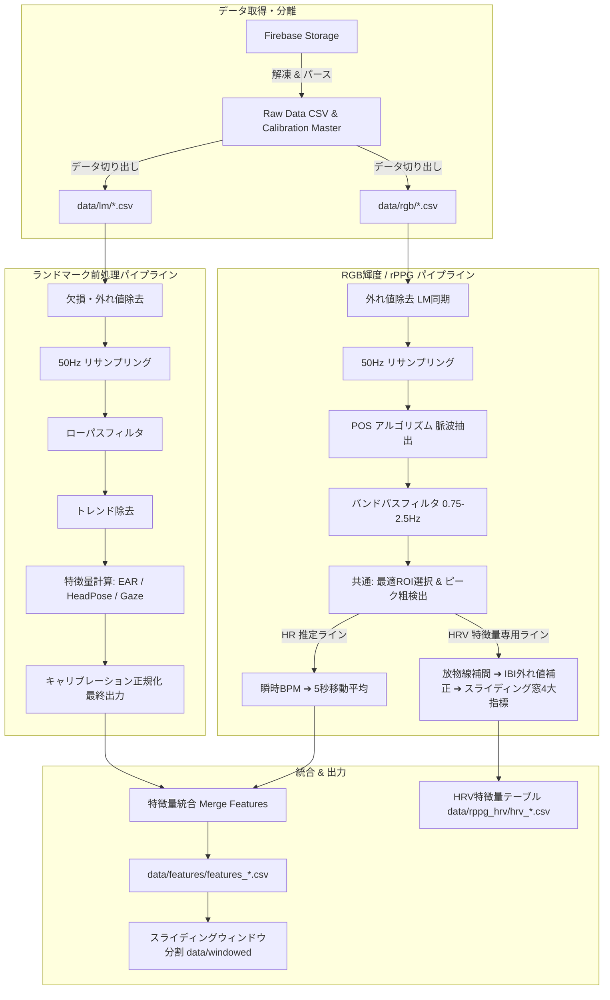

# Preprocessing (生体シグナル前処理・特徴量抽出パイプライン)

本ディレクトリは、データ収集システム（`data_collect`）で取得した顔ランドマーク座標およびRGB輝度シグナル（rPPG）に対して、前処理を実行する用のものです。

---

## プロジェクト概要

データ収集システムによって計測・収集された被験者の時系列生体シグナル（MediaPipeによる顔ランドマーク座標および顔頬部RGB平均値）を受け取り、オンライン学習時の集中度・覚醒度推定AIモデルへ入力可能な高品質な特徴量データセットを生成します。

---

## 主な機能・パイプラインフロー

### 1. ランドマーク処理工程（全8ステップ）

1. **Storageからファイル取得:** Firebase Cloud Storageから`.json.gz`データを自動取得・解凍
2. **Landmark, RGB値別にファイル作成:** Rawデータからランドマーク列とRGB列を分離してCSV保存
3. **欠損値・外れ値除去:** 顔未検出（全0・NaN）のマスク処理、急激なスパイクノイズの検出と線形補間
4. **リサンプリング:** タイムスタンプに基づく 50Hz（20ms周期）の等間隔化およびPCHIP補間
5. **フィルタリング:** 手振れや高周波ジッターを除去するバターワース・ローパスフィルタ（遮断周波数 3〜5Hz）
6. **トレンド除去:** 姿勢の長期的ドリフトを除去（移動平均差分・ベースライン補正）
7. **特徴量計算:**
   - **EAR (Eye Aspect Ratio):** 3Dランドマークに基づく個人最適化瞬目指標
   - **Head Pose:** 3次元頭部回転角（Pitch, Yaw, Roll）
   - **Gaze:** 眼球回転角・視線方向（Horizontal / Vertical）
8. **キャリブレーションを用いた正規化（最終出力）:** 実験前5秒間の正面注視キャリブレーション値との比率（`ear_ratio`）および差分（`*_diff`）算出

### 2. RGB輝度シグナル / 脈波（rPPG）処理工程（全7ステップ & 2ライン分岐）

1. **Storageからファイル取得:** ランドマークと共通
2. **Landmark, RGB値別にファイル作成:** ランドマークと共通
3. **欠損値・外れ値除去:** ランドマーク側の顔未検出フレームと同期した欠損補正
4. **リサンプリング:** タイムスタンプに基づく 50Hz 等間隔化（PCHIP補間）
5. **POS Methodによる脈波検出:** 原著論文（Wang et al., 2017）準拠の Plane-Orthogonal-to-Skin アルゴリズムにより、色空間投影から血流脈波（BVP）シグナルを抽出（両頬・左頬・右頬の3領域）
6. **バンドパスフィルタリング:** 人間の想定心拍数（45〜150 BPM ≒ 0.75〜2.5Hz）に合わせた2次バターワース・バンドパスフィルタ
7. **生体指標算出 & 2ライン分岐:** 最適ROI領域のSNR（Signal-to-Noise Ratio）評価・選択および共通ピーク粗検出後、用途別に2つのラインへ分岐：
   - **【HR 推定ライン】**: ピーク間隔から瞬時心拍数（BPM）を算出し、指定秒数（デフォルト: 5秒）の移動平均フィルタを適用して平滑化時系列（`bpm`）を出力
   - **【HRV 特徴量専用ライン】**:
     1. 3点放物線フィッティングによるサブサンプル補間（ピーク時刻をミリ秒精度へ補正）
     2. `nk.signal_fixpeaks(method='Kubios')` によるIBI外れ値・異所性拍の検出と補正
     3. 45〜60秒のスライディング窓（1秒ストライド）による時系列分割
     4. NeuroKit2による4大指標（`rmssd`, `sdnn`, `sd2/sd1`, `mean_pp`）の算出
     5. 機械学習用特徴量テーブル（`data/rppg_hrv/hrv_*.csv`）の出力

### 3. 特徴量統合 & ウィンドウ分割

- **特徴量統合 (Merge):** ランドマーク特徴量と脈波・心拍指標（`bpm`, `bpm_raw`, `bvp_selected`, `ppg_peaks` 等）をタイムスタンプ基準で高精度に結合し、被験者単位の最終特徴量ファイル（`data/features/features_*.csv`）を作成
- **スライディングウィンドウ分割:** 機械学習・時系列深層学習（TS2Vec等）向けに、可変長ウィンドウ（5秒/10秒/15秒）とストライド（1秒）でシーケンス分割。動画切り替え時や視聴開始・終了時のノイズ影響を排除するため、ラベル境界を跨がない分割に加え、ラベル別の開始・終了マージン除外（label 1 の最初15秒・最後4秒、label 0 の最初15秒）を適用
- **HRV特徴量テーブル:** 独立した機械学習用特徴量テーブルとして `data/rppg_hrv/` に保存され、感情・ストレス・集中度推定モデルの入力として活用可能

---

## パイプライン・データフロー



---

## 主要ファイル構成

```text
preprocess/
├── README.md                 # 本ドキュメント
├── LICENSE                   # プロジェクトライセンス
├── config.yaml               # パイプライン全体の設定・パラメータファイル
├── config_loader.py          # YAML設定ロード・ロガー初期化モジュール
├── main.py                   # コマンドライン実行エントリーポイント
│
├── collect/                  # データ取得・解凍・CSV初期変換
│   ├── firebase_handler.py   # Firebase Storage ダウンロード処理
│   ├── data_processor.py     # .json.gz 解凍、JSONパース、Raw CSV化
│   ├── local_gz_csv.py       # ローカルファイル一括変換
│   └── utils.py              # ZIPアーカイブ作成等ユーティリティ
│
├── cutting/                  # Raw データ切り出し
│   └── cutting.py            # Raw CSVからLM用とRGB用CSVを分離
│
├── cleaning/                 # 欠損値・スパイク・外れ値除去
│   ├── lm_cleaner.py         # ランドマーク欠損マスク & スパイク線形補間
│   └── rgb_cleaner.py        # RGB値欠損処理（LM顔未検出同期）
│
├── resampling/               # タイムスタンプ等間隔リサンプリング (50Hz)
│   ├── lm_resampler.py       # ランドマーク PCHIP補間等間隔化
│   └── rgb_resampler.py      # RGB輝度 PCHIP補間等間隔化
│
├── filtering/                # 周波数帯域フィルタリング
│   ├── lowpass_filter.py     # ランドマーク用 Butterworth ローパスフィルタ
│   └── bandpass_filter.py    # rPPG脈波用 Butterworth バンドパスフィルタ
│
├── detrending/               # ドリフト・トレンド除去
│   └── detrend.py            # 移動平均差分・ベースライン補正
│
├── features/                 # 特徴量抽出・アルゴリズム実装
│   ├── lm/
│   │   ├── lm_extractor.py       # ランドマーク特徴量一括抽出処理
│   │   ├── feature_calculator.py # 後方互換性エイリアス (calibration/feature_calculator.py へ移行)
│   │   └── cal_calibration.py    # 後方互換性エイリアス (calibration/lm_calibration.py へ移行)
│   └── rppg/
│       ├── pos_algorithm.py      # POS アルゴリズムによる脈波抽出
│       ├── hr_extraction.py      # 心拍数算出・HR推定ライン平滑化統括
│       ├── hrv_extraction.py     # HRV 特徴量専用ライン (放物線補間・Kubios補正・4大指標)
│       ├── roi_selector.py       # 最適ROI領域判定（SNR比較）
│       └── sqi.py                # 信号品質指数 (SQI) 算出
│
├── calibration/              # 静止時キャリブレーション処理
│   ├── lm_calibration.py     # キャリブレーションマスター生成 & 個人正規化
│   └── feature_calculator.py # EAR・頭部姿勢・眼球回転角幾何計算コア
│
├── normalization/            # 正規化
│   └── normalizer.py         # キャリブレーション正規化モジュール
│
├── pipeline/                 # パイプライン統括オーケストレーター
│   ├── lm_pipeline.py        # ランドマーク処理パイプライン (Step 1〜8)
│   ├── rgb_pipeline.py       # 脈波処理パイプライン (Step 1〜7)
│   └── pipeline.py           # 全工程一括実行 & ディスク/インメモリ統合
│
├── windowing/                # 機械学習向け時系列分割
│   ├── window_generator.py   # スライディングウィンドウ抽出コアロジック
│   ├── trim_margins.py       # ラベル別マージン除外ロジック
│   └── sliding_windows.py    # 後方互換性・CLI実行エントリーポイント
│
└── data/                     # 処理データ入出力先 (Git管理対象外)
    ├── raw/                  # ダウンロード済み Raw CSV & キャリブレーションマスター
    ├── lm/                   # 切り出し後ランドマーク CSV
    ├── rgb/                  # 切り出し後RGB輝度 CSV
    ├── lm_calibrated/        # ランドマーク最終正規化データ
    ├── rppg_hr_extracted/    # 生体指標算出完了データ
    ├── rppg_hrv/             # HRV 4大指標スライディング窓特徴量テーブル (hrv_*.csv)
    ├── features/             # 最終統合特徴量 CSV (features_*.csv)
    └── windowed/             # ウィンドウ分割済みデータ
```

---

## セットアップ & 必要要件

### 動作環境

- Python 3.10 以上 (uv 推奨)
- [uv](https://docs.astral.sh/uv/) パッケージマネージャー

### 依存パッケージのインストール

リポジトリルートで以下を実行します：

```bash
uv sync
```

---

## 実行方法

### パイプライン全工程の一括実行

```bash
# プロジェクトルートから実行
uv run python preprocess/main.py --stage all

# または preprocess ディレクトリから実行
cd preprocess
uv run python main.py --stage all
```

*Firebase Storageからのデータ取得、データ切り出し、ランドマーク8工程、RGB7工程、特徴量マージ、スライディングウィンドウ分割までを一括で順次実行します。*

> [!TIP]
> **中間ファイルの自動クリーンアップ仕様**:
>
> - **成功時**: パイプライン処理がすべて正常に完了すると、ディスク容量節約のため不要となった中間ファイル（`lm_*`, `rgb_*`, `rppg_*` 等）を自動削除し、最終成果物（`data/raw`, `calibration_master.csv`, `data/features`, `data/windowed`）のみを残します。
> - **失敗時**: 処理中にエラーが発生した場合は、原因調査・デバッグのため直前までの中間ファイルが自動で保持されます。
> - **中間ファイルを保持したい場合**: `--keep-intermediates` フラグを付与して実行してください。
>
> ```bash
> # 中間ファイルを削除せずに保持して実行
> uv run python preprocess/main.py --keep-intermediates
> ```

### 個別工程・グループ別実行

`--stage` 引数に実行したい工程名を指定します（複数指定可能）。

```bash
# ランドマーク工程のみ全実行
uv run python preprocess/main.py --stage lm

# RGB / 脈波工程のみ全実行
uv run python preprocess/main.py --stage rgb

# ランドマークとRGBの特徴量統合のみ実行
uv run python preprocess/main.py --stage merge

# ダウンロードと切り出しのみ実行
uv run python preprocess/main.py --stage download cutting

# ランドマークの特定工程のみ実行
uv run python preprocess/main.py --stage lm_clean lm_resample lm_filter
```

### 指定可能な `--stage` 一覧

| ステージ指定名 | 説明 |
| :--- | :--- |
| `all` | 全パイプラインの一括実行 |
| `download` | Firebase Storage からのデータ取得・初期変換 |
| `cutting` | Raw CSV からランドマーク・RGB への分離切り出し |
| `lm` | ランドマーク前処理の全8工程を一括実行 |
| `rgb` | RGB / rPPG 前処理の全7工程を一括実行（HR推定・移動平均 & HRV特徴量算出含む） |
| `merge` | 最終ランドマーク特徴量と生体指標の統合 |
| `windowing` | 被験者別・ラベル(0/1)別スライディングウィンドウ作成 |
| `lm_clean`, `lm_resample`, `lm_filter`, `lm_detrend`, `lm_feat` | ランドマーク各個別工程 |
| `lm_calib`, `lm_norm` | ランドマーク キャリブレーション正規化工程（最終出力） |
| `rgb_clean`, `rgb_resample`, `rgb_pos`, `rgb_filter` | RGB 各個別工程（クレンジング、リサンプリング、POS脈波抽出、バンドパスフィルタ） |
| `rgb_hr`, `rgb_hrv`, `hrv` | 生体指標算出（最適ROI選択、瞬時BPM、5秒移動平均平滑化、およびHRV特徴量専用ライン） |

---

## 入力データと出力データ仕様

### 1. 入力データ形式

- **データ収集システム（`data_collect`）の出力 JSON (`.json.gz`)**
  - `calibration`: 計測開始前5秒間の静止時キャリブレーション記録（EAR平均、頭部回転角、視線方向）
  - `records`: 時系列計測データ（タイムスタンプ、478箇所の顔ランドマーク 3D 座標、両頬/左右頬の平均 RGB 輝度値）

### 2. 最終出力特徴量（`data/features/features_*.csv`）

マージ完了後の CSV に含まれる主な特徴量カラム（50Hz等間隔時系列）：

| カラムカテゴリ | 主なカラム名 | 説明 |
| :--- | :--- | :--- |
| **時間情報** | `time` | 基準開始時からの経過時間（秒、50Hz等間隔） |
| **瞬目・眼球指標** | `ear_avg`, `ear_ratio` | 眼アスペクト比（EAR）およびキャリブレーション基準比 |
| **頭部姿勢** | `head_pitch_diff`, `head_yaw_diff`, `head_roll_diff` | 静止基準位置からの頭部姿勢回転角（度）の変位 |
| **視線・眼球回転** | `gaze_h_deg_diff`, `gaze_v_deg_diff` | 水平・垂直方向の視線角変位（度） |
| **脈波・生体指標** | `bvp_selected` | 最適ROIから抽出・フィルタリングされた血流脈波（rPPG）波形 |
| | `bpm` | ピーク間隔より算出した心拍数に5秒移動平均を適用した平滑化BPM（Beats Per Minute） |
| | `bpm_raw` | 移動平均適用前の瞬時生心拍数（Raw BPM） |
| | `ppg_peaks` | 検出された脈波ピーク位置フラグ（0 または 1） |
| | `snr_db` | 脈波信号の信号対雑音比（Signal-to-Noise Ratio, dB） |
| | `selected_roi` | 自動選択された最適顔領域（`both`, `left`, `right`） |

### 3. HRV 4大指標特徴量テーブル（`data/rppg_hrv/hrv_*.csv`）

サブサンプル補間（放物線近似）とKubios外れ値補正を経たピーク時刻系列から、スライディング窓（デフォルト: 45秒窓、1秒ストライド）で算出した自律神経系・HRV指標テーブル：

| カラム名 | 単位 | 説明 |
| :--- | :--- | :--- |
| `window_start`, `window_end` | 秒 | スライディング窓の開始時刻および終了時刻 |
| `window_center` | 秒 | スライディング窓の中心時刻（タイムスタンプ同期基準） |
| `mean_pp` | ms | 窓内平均ピーク間隔（平均NN間隔 / 脈拍周期） |
| `rmssd` | ms | 連続するピーク間隔差の二乗平均平方根（副交感神経活動指標） |
| `sdnn` | ms | ピーク間隔全体の標準偏差（自律神経全体の活動度指標） |
| `sd2_sd1` | 比率 | ポアンカレプロット長軸径（SD2）と短軸径（SD1）の比率（自律神経バランス指標） |
| `n_peaks` | 拍 | 当該ウィンドウ内で検出・採用された有効脈波拍数 |

---

## 設定ファイル（`config.yaml`）の概要

前処理の動作パラメータはすべて `config.yaml` で集約管理されています。

```yaml
# 主要設定抜粋
paths:
  data_root: "data"
  raw_dir: "data/raw"
  output_dir: "data/features"      # 統合特徴量の保存先
  rppg_hrv_dir: "data/rppg_hrv"    # HRV特徴量テーブルの保存先

landmarks:
  r_eye: 11.7                      # 平均眼球半径 (mm)
  default_fps: 50.0                # リサンプリング基準周波数 (Hz)

rppg:
  fs: 50.0                         # 脈波解析サンプリングレート (Hz)
  pos:
    window_sec: 1.6                # POS スライディングウィンドウ長 (秒)
  filter:
    lowcut: 0.75                   # 0.75Hz ≒ 45 BPM
    highcut: 2.5                   # 2.5Hz ≒ 150 BPM
    order: 2                       # バターワースフィルタ次数

# 【HR 推定ライン】心拍数 (BPM) 移動平均設定
moving_average:
  enabled: true                    # 移動平均フィルタを適用するか (true/false)
  window_sec: 5.0                  # 窓長 (秒)
  center: false                    # 過去窓 (リアルタイム/因果的: false) / 中心窓 (true)

# 【HRV 特徴量専用ライン】設定
hrv:
  enabled: true                    # HRV 4大指標の算出を行うか (true/false)
  window_sec: 45.0                 # スライディング窓長 (秒, 45〜60秒推奨)
  stride_sec: 1.0                  # スライド幅 (秒)
  save_csv: true                   # CSV保存フラグ

# 【生体指標キャリブレーション】10秒ウィンドウ内完結 差分キャリブレーション (外部ベースライン撤廃)
rppg_calibration:
  enabled: true                    # 差分キャリブレーションの有効化 (true/false)
  window_sec: 10.0                 # 相対特徴算出ウィンドウ幅 (秒)
  target_cols: ["bpm", "bvp_selected"]
  baseline_method: "mean"          # 局所基準値の算出手法 ('mean', 'median', 'initial')
  center: false                    # 過去窓 (リアルタイム/因果的: false) / 中心窓 (true)

windowing:
  window_secs: [5, 10, 15]         # 機械学習入力用ウィンドウ長（秒）
  stride_sec: 1.0                  # スライド幅（秒）
  target_fs: 50.0                  # サンプリング周波数 (Hz)
  max_nan_ratio: 0.1               # 許容する最大欠損率
  
  # ラベル別除外区間設定（秒）
  # - label 1: 最初の15秒間、最後の4秒間を除外
  # - label 0: 最初の15秒間を除外
  trim_margins:
    0:
      start_sec: 15.0
      end_sec: 0.0
    1:
      start_sec: 15.0
      end_sec: 4.0
```
