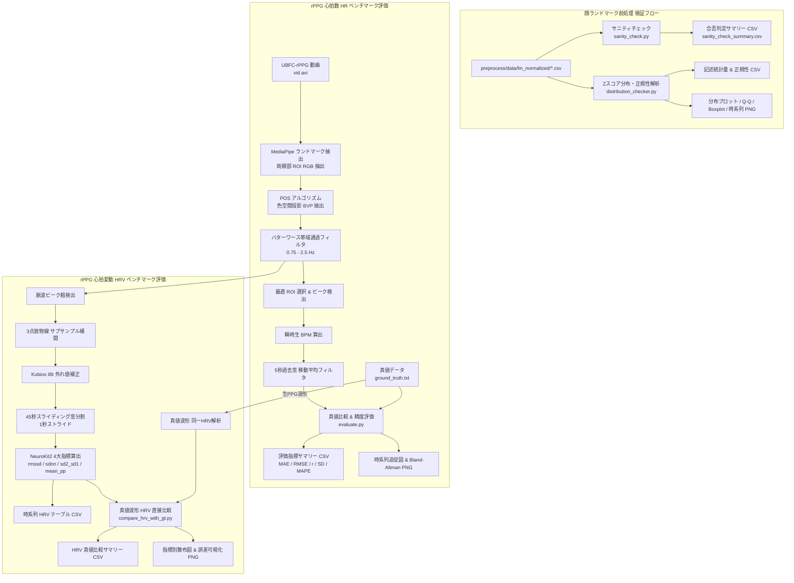

# Validation (生体シグナル前処理・抽出品質 検証基盤)

本ディレクトリは、生体シグナルパイプライン（顔ランドマーク `LM` および 非接触脈波 `rPPG`）における前処理および特徴量抽出の妥当性・数学的整合性・推定精度を包括的に検証するための統合バリデーション基盤です。

---

---

## プロジェクト概要


前処理パイプライン（`preprocess/`）によって生成された特徴量データセット（ランドマーク幾何・微分・Zスコア特徴量およびrPPG脈波・心拍指標）が、機械学習モデルの入力として妥当な品質・数学的整合性を満たしているかを検証します。

また、公開されている医療用生体計測ベンチマークデータセット（**UBFC-rPPG**）を用い、接触型センサ（パルスオキシメータ）による真値（Ground Truth）心拍数（HR）および心拍変動（HRV）に対するカメラ映像ベース非接触脈波抽出（rPPG）の精度と追従性を厳密に定量評価します。

### 検証の目的と重要性

1. **数学的・統計的健全性の保証:** サンプリング周波数ゆらぎ、欠損値、無限大（Inf）、個人内標準化（$\mu=0, \sigma=1$）のズレをサニティチェックで検出し、AI学習時の勾配爆発やバイアス混入を未然に防止します。
2. **生体信号推定精度の客観的立証:** 非接触で推定したBPMおよびHRV指標（RMSSD, SDNN, SD2/SD1, 平均NN）を真値波形と比較し、MAE, RMSE, 相関係数 $r$ 等で定量化することで、特徴量の信頼性を裏付けます。
3. **パラメータ最適化の検証:** 移動平均窓長（5秒）やスライディング窓長（45秒）、ROI選択アルゴリズムの効果を可視化・定量評価し、最適な設定パラメータを導出します。

---

## 主な機能・検証パイプラインフロー

### 1. 顔ランドマーク前処理検証（LM: サニティチェック & Zスコア分布解析）

前処理パイプラインによって生成された `preprocess/data/lm_normalized/` 配下の各被験者ファイルに対し、全8項目のサニティチェックと18特徴量の統計分布分析を実施します。

1. **サニティチェック（健全性自動検証）:**
   - 行数・データ長チェック（最低50フレーム以上）
   - 欠損値（NaN）許容率チェック（0.1%以下）
   - 微分や除算に起因する無限大（$\pm \infty$）の完全排除
   - タイムスタンプの時間軸単調増加性チェック（$\Delta t > 0$）
   - 50Hz等間隔リサンプリング誤差チェック（許容誤差 $\le 5\,\mathrm{ms}$）
   - 人間の身体的可動域に基づく物理レンジ境界チェック（EAR比率、頭部回転角、視線角）
   - 個人内Zスコア標準化の整合性（$|\mu| \le 0.01$, $|\sigma - 1.0| \le 0.01$）
   - 高周波ノイズ・スパイク検知（$|Z| > 8.0$）
2. **統計分布確認 & 正規性評価:**
   - 対象18特徴量（EAR, Head Pose 3軸, Gaze 2軸の各平滑化値・1階微分速度・2階微分加速度）の記述統計量（平均、標準偏差、歪度、尖度、外れ値比率）算出
   - 理論正規分布 $\mathcal{N}(0, 1)$ に対するガウス曲線重ね描きヒストグラム & KDE解析
   - 理論正規分布に対する Q-Q（Quantile-Quantile）プロット
   - 被験者間でのZスコア分布均一性を検証する箱ひげ図（Boxplot）
   - 代表被験者の時系列プレビュー波形描画

### 2. 非接触脈波（rPPG）心拍数ベンチマーク評価（HR 推定ライン）

公開動画データ（UBFC-rPPG）からMediaPipeを用いて両頬部ROIを抽出し、原著論文（Wang et al., 2017）準拠のPOS法により脈波を抽出して心拍数推定精度を接触真値と比較検証します。

1. **両頬部ROI RGB輝度抽出:** MediaPipe FaceLandmarker（478点）を用いて左頬・右頬のランドマークを追従し、各20px矩形領域のRGB平均時系列を抽出
2. **POSアルゴリズムによる脈波抽出:** 色空間投影により血流脈波（BVP）シグナルを抽出（両頬・左頬・右頬の3領域）
3. **帯域通過フィルタリング:** 2次バターワース・バンドパスフィルタ（0.75〜2.5Hz ≒ 45〜150 BPM）を適用
4. **最適ROI自動選択 & ピーク検出:** 各ROI領域のSNR（Signal-to-Noise Ratio）を比較し、最も良好な領域を選択して脈波ピークを検出
5. **瞬時BPM算出 & 5秒移動平均平滑化:** ピーク間隔から瞬時心拍数（BPM）を算出し、5秒過去窓移動平均フィルタを適用
6. **真値比較 & 精度評価:** 同期した接触型真値BPMとの誤差指標（MAE, RMSE, Pearson $r$, SD, MAPE）を算出し、時系列追従グラフおよびBland-Altmanプロットを描画

### 3. 非接触脈波（rPPG）心拍変動解析ベンチマーク（HRV 特徴量専用ライン）

脈波ピーク系列に対して高精度な補間と外れ値補正を施し、自律神経系4大指標を算出して真値波形由来のHRVと定量比較します。

1. **3点放物線サブサンプル補間:** 離散サンプリングによるピーク位置を放物線フィッティングによりミリ秒以下の実時間精度へ補正
2. **IBI外れ値補正 (Kubios法):** `nk.signal_fixpeaks(method='Kubios')` を用いて拍間隔の急峻なアーティファクト・誤検出・欠落拍を補正
3. **スライディング窓分割:** 45秒スライディング窓（1秒ストライド）で時系列を切り出し
4. **自律神経系4大指標の算出:** NeuroKit2を用いて `mean_pp`（平均NN間隔）、`rmssd`（副交感神経活動）、`sdnn`（全自律神経変動）、`sd2_sd1`（自律神経バランス比）を算出
5. **接触真値PPG波形との直接定量比較:** 被験者の真値生PPG波形（`ground_truth.txt` 第1カラム）にも同一のHRVパイプラインを適用し、カメラ映像由来HRVとの直接相関・散布図・推定誤差サマリーを出力

---

## 検証パイプライン・データフロー



---

## 主要ファイル構成

```text
validation/
├── README.md                      # 本ドキュメント
├── config_loader.py               # 【共通基盤】設定ロード、CLI引数反映、パス自動探索・解決
│
├── lm/                            # ==========================================
│   │                              # 顔ランドマーク前処理 検証スイート
│   │                              # ==========================================
│   ├── config.yaml                # LM 検証用設定ファイル (閾値・対象カラム・描画設定)
│   ├── config_loader.py           # validation/config_loader.py へのプロキシ
│   ├── sanity_check.py            # サニティチェック専門モジュール (LMSanityChecker)
│   ├── distribution_checker.py    # Zスコア分布分析・可視化モジュール (LMDistributionChecker)
│   ├── run_lm_validation.py       # LM 検証メイン CLI エントリポイント
│   └── result/                    # 検証結果 CSV & プロット画像出力先
│       ├── sanity_check_summary.csv         # 全被験者のサニティチェック合否一覧
│       ├── sanity_check_details.csv         # チェック項目別の詳細判定ログ
│       ├── lm_zscore_metrics_overall.csv    # 全被験者統合 記述統計量 & 正規性検定サマリー
│       ├── lm_zscore_metrics_by_subject.csv # 被験者別 記述統計量サマリー
│       ├── lm_zscore_distribution.png      # 18特徴量の分布ヒストグラム & KDE + N(0, 1) 重ね描き
│       ├── lm_zscore_qq_plots.png          # 18特徴量の正規 Q-Q プロット
│       ├── lm_subject_boxplots.png         # 被験者ごとの Zスコア均一性比較 (箱ひげ図)
│       └── lm_timeline_preview.png         # 代表被験者の Zスコア時系列波形プレビュー
│
└── rppg/                          # ==========================================
    │                              # 非接触脈波 (rPPG) ベンチマーク評価スイート
    │                              # ==========================================
    ├── config_loader.py           # 後方互換用プロキシ
    ├── face_landmarker_extractor.py # 動画からの両頬部 (ROI) RGB 輝度抽出
    ├── datasets/                  # 評価用データセット (UBFC-rPPG: subject1, 3, 4, 5, 8)
    │   ├── subject1/
    │   │   ├── vid.avi            # 非圧縮顔動画
    │   │   └── ground_truth.txt   # 接触型真値 (PPG波形, 心拍数, タイムスタンプ)
    │   ├── subject3/
    │   ├── subject4/
    │   ├── subject5/
    │   └── subject8/
    │
    ├── hr/                        # 【HR 推定ライン】心拍数ベンチマーク
    │   ├── config.yaml            # HR 用設定ファイル
    │   ├── evaluate.py            # HR ベンチマーク評価メインスクリプト
    │   ├── rppg_preprocessor.py   # POS 脈波抽出・帯域フィルタ・瞬時 BPM 算出
    │   ├── metrics_evaluator.py   # HR 評価指標算出 (MAE, RMSE, Pearson r, SD, MAPE)
    │   ├── moving_average.py      # 5秒移動平均平滑化フィルタ
    │   ├── plotter.py             # 時系列追従グラフ & Bland-Altman プロット描画
    │   └── result/                # HR 評価結果出力先
    │       ├── pred_subject*.csv            # 被験者ごとの推定 BPM 時系列
    │       ├── evaluation_summary.csv       # 全被験者・被験者別 HR 評価指標一覧
    │       ├── plot_subject*.png            # 被験者別 時系列追従プロット
    │       └── hr_comparison.png            # 全被験者統合 時系列追従比較図
    │
    └── hrv/                       # 【HRV 特徴量専用ライン】心拍変動ベンチマーク
        ├── config.yaml            # HRV 用設定ファイル
        ├── evaluate_hrv.py        # HRV 特徴量抽出メインスクリプト
        ├── compare_hrv_with_gt.py # 接触真値波形 HRV との直接比較スクリプト
        ├── hrv_preprocessor.py    # サブサンプル補間・Kubios外れ値補正・窓解析統括
        ├── plotter_hrv.py         # 時系列推移・ポアンカレプロット描画
        └── result/                # HRV 評価結果出力先
            ├── hrv_subject*.csv             # 被験者ごとの 4大指標時系列テーブル
            ├── hrv_summary.csv              # 全被験者 HRV 記述統計サマリー
            ├── plot_hrv_subject*.png        # 被験者別 HRV 時系列 & ポアンカレ図
            ├── hrv_comparison.png           # 全被験者統合 HRV 比較図
            └── gt_comparison/               # 真値比較結果
                ├── gt_hrv_subject*.csv      # 接触真値波形から算出した HRV テーブル
                ├── comparison_subject*.csv  # カメラHRVと真値HRVの同期突合データ
                ├── hrv_gt_comparison_summary.csv # 指標別 相関・誤差サマリー
                ├── plot_gt_comp_subject*.png     # 被験者別 真値追従・散布図プロット
                └── hrv_gt_overall_errors.png     # 全指標統合 誤差箱ひげ図
```

---

## 共通基盤: `config_loader.py`

設定管理とファイルパス解決を一元化するため、`validation/config_loader.py` を提供しています。

### 主な責務と設計特徴

1. **YAML設定ファイルの柔軟なロード:** 実行ディレクトリ（プロジェクトルート、サブディレクトリ、別モジュール）に依存せず、相対パス・絶対パスの双方から安全に設定 YAML を読み込みます。
2. **CLI 引数の自動マージ:** コマンドラインから渡された引数（`--subjects`, `--data-dir`, `--output-dir`, `--no-plots` 等）を設定辞書へ自動的にオーバーライドします。
3. **動的パス探索・自動解決:**
   - `dataset_dir`: `validation/rppg/datasets` をプロジェクト構造に基づいて自動探索。
   - `model_path`: `make_ai/face_landmarker.task` をルートから探索して自動解決。
   - `data_dir` / `lm_normalized_dir`: `preprocess/data/lm_normalized` 等の前処理データを自動解決。
4. **透過的プロキシ（後方互換性）:** `validation/rppg/config_loader.py` および `validation/lm/config_loader.py` から透過的に再エクスポートされ、既存の各サブディレクトリ内スクリプトのインポート互換性を完全に保証します。

---

## 開発環境・セットアップ

### 1. 前提要件

- **Python:** `3.12` 以上推奨
- **MediaPipe Task ファイル:** `make_ai/face_landmarker.task` がプロジェクトルートに配置されていること
- **ベンチマークデータセット:** `validation/rppg/datasets/` 配下に UBFC-rPPG の各被験者データ（`vid.avi`, `ground_truth.txt`）が配置されていること

### 2. 環境構築 (uv による統一管理)

プロジェクトルートの `pyproject.toml` にて、`validation` で使用するライブラリ（`mediapipe`, `opencv-python`, `matplotlib`, `neurokit2` 等）は開発用依存関係（`[dependency-groups] dev`）として一括管理されています。

```bash
# プロジェクトルートへ移動
cd make_ai

# 開発依存関係を含めて環境を同期 (仮想環境 .venv を自動構築)
uv sync
```

> [!NOTE]
> `uv sync` を実行することで、ルート直下の `.venv` に全パッケージが自動的に導入されます。個別にサブディレクトリ内で仮想環境を作成したり `pip install` を実行する必要はありません。

---

## 実行方法

### 1. 顔ランドマーク前処理検証 (`validation/lm/`)

```bash
# 全工程 (サニティチェック + 分布可視化) を一括実行
uv run python validation/lm/run_lm_validation.py

# サニティチェックのみ実行 (高速実行)
uv run python validation/lm/run_lm_validation.py --mode sanity

# 分布確認・可視化のみ実行
uv run python validation/lm/run_lm_validation.py --mode dist

# 特定のデータディレクトリを指定して実行
uv run python validation/lm/run_lm_validation.py --data-dir preprocess/data/lm_normalized

# グラフプロット画像の保存をスキップして高速実行
uv run python validation/lm/run_lm_validation.py --no-plots
```

### 2. rPPG 心拍数ベンチマーク評価 (`validation/rppg/hr/`)

```bash
# 全被験者の一括評価 (5秒移動平均平滑化あり)
uv run python validation/rppg/hr/evaluate.py --config validation/rppg/hr/config_ver2.yaml

# 特定被験者のみを対象として評価
uv run python validation/rppg/hr/evaluate.py --config validation/rppg/hr/config_ver2.yaml --subjects subject1 subject5

# プロット描画をスキップ
uv run python validation/rppg/hr/evaluate.py --config validation/rppg/hr/config_ver2.yaml --no-plots
```

### 3. rPPG 心拍変動 (HRV) ベンチマーク評価 (`validation/rppg/hrv/`)

```bash
# 全被験者の HRV 抽出 & ポアンカレプロット生成
uv run python validation/rppg/hrv/evaluate_hrv.py --config validation/rppg/hrv/config.yaml

# 接触真値波形から算出した HRV との直接定量比較・散布図作成
uv run python validation/rppg/hrv/compare_hrv_with_gt.py --config validation/rppg/hrv/config.yaml

# 特定被験者のみ真値比較を実行
uv run python validation/rppg/hrv/compare_hrv_with_gt.py --config validation/rppg/hrv/config.yaml --subjects subject1 subject3
```

---

## 検証項目・合否判定基準および出力データ仕様

### 1. 顔ランドマーク サニティチェック合格基準 (`validation/lm/`)

| チェック項目 | 検証内容 | 合否判定基準 (PASS) |
| :--- | :--- | :--- |
| **データ構造・行数** | 各被験者ファイルの行数が極端に不足していないか | $\ge 50$ 行 |
| **欠損値 (NaN)** | 各特徴量の欠損値比率が許容値以下に収まっているか | $\le 0.1\%$ |
| **無限大 (Inf)** | 微分演算やゼロ除算による $\pm \infty$ が混入していないか | $0$ 件 (厳格判定) |
| **時間軸単調性** | タイムスタンプに逆行・巻き戻りや重複が存在しないか | 厳密に単調増加 ($\Delta t > 0$) |
| **サンプリング整合性** | リサンプリング後の周期が $50\,\mathrm{Hz}$ ($\Delta t = 0.02\,\mathrm{s}$) に一致しているか | 期待値との誤差 $\le 5\,\mathrm{ms}$ |
| **物理レンジ妥当性** | EAR比率、頭部回転角、視線角が人間の身体的可動域に収まっているか | EAR比率 $[0.0, 5.0]$<br>頭部回転角 $[-90.0^\circ, 90.0^\circ]$<br>視線角 $[-60.0^\circ, 60.0^\circ]$ |
| **個人内 Zスコア整合性** | 各被験者の各特徴量で個人内標準正規化 $(\mu=0, \sigma=1)$ が正しく成立しているか | 平均のズレ $|\mu| \le 0.01$<br>標準偏差のズレ $\|\sigma - 1.0\| \le 0.01$ |
| **極端スパイク検知** | 高周波ノイズや微分による極端なスパイクが存在しないか | $\|Z\| > 8.0$ のフレームを検知 (警告レベル) |

### 2. 対象 18 種類の Zスコア特徴量一覧

| 特徴量カテゴリ | 元特徴量名 | 1階微分 (速度) | 2階微分 (加速度) | 説明 |
| :--- | :--- | :--- | :--- | :--- |
| **瞬目指標** | `ear_ratio_smooth_z` | `ear_ratio_vel_smooth_z` | `ear_ratio_acc_smooth_z` | 個人最適化Eye Aspect Ratio比率の標準化値 |
| **頭部 Pitch** | `head_pitch_diff_smooth_z` | `head_pitch_diff_vel_smooth_z` | `head_pitch_diff_acc_smooth_z` | 静止基準位置からの上下回転角変位 |
| **頭部 Yaw** | `head_yaw_diff_smooth_z` | `head_yaw_diff_vel_smooth_z` | `head_yaw_diff_acc_smooth_z` | 静止基準位置からの左右首振り回転角変位 |
| **頭部 Roll** | `head_roll_diff_smooth_z` | `head_roll_diff_vel_smooth_z` | `head_roll_diff_acc_smooth_z` | 静止基準位置からの左右傾き回転角変位 |
| **視線垂直角** | `gaze_v_deg_diff_smooth_z` | `gaze_v_deg_diff_vel_smooth_z` | `gaze_v_deg_diff_acc_smooth_z` | 垂直方向の視線角変位 |
| **視線水平角** | `gaze_h_deg_diff_smooth_z` | `gaze_h_deg_diff_vel_smooth_z` | `gaze_h_deg_diff_acc_smooth_z` | 水平方向の視線角変位 |

### 3. rPPG 心拍数 (HR) 評価指標

| 評価指標 | 略称 | 単位 | 計算式 | 意味 |
| :--- | :--- | :--- | :--- | :--- |
| **平均絶対誤差** | MAE | $\text{BPM}$ | $\frac{1}{N}\sum \|y_i - \hat{y}_i\|$ | 真値心拍数との平均的な絶対ズレ幅 |
| **二乗平均平方根誤差** | RMSE | $\text{BPM}$ | $\sqrt{\frac{1}{N}\sum (y_i - \hat{y}_i)^2}$ | 大きな誤差に対してペナルティを重くした誤差指標 |
| **ピアソン相関係数** | Pearson $r$ | なし | $\frac{\sum (y_i - \bar{y})(\hat{y}_i - \bar{\hat{y}})}{\sqrt{\sum (y_i - \bar{y})^2 \sum (\hat{y}_i - \bar{\hat{y}})^2}}$ | 真値と推定値の線形追従性・波形相関 |
| **誤差標準偏差** | SD | $\text{BPM}$ | $\sqrt{\frac{1}{N}\sum (e_i - \bar{e})^2}$ | 誤差のばらつき（推定の安定性） |
| **平均絶対パーセント誤差** | MAPE | $\%$ | $\frac{100}{N}\sum \|\frac{y_i - \hat{y}_i}{y_i}\|$ | 相対的な心拍数誤差率 |

### 4. rPPG 心拍変動 (HRV 4大指標) 仕様

| 指標名 | 単位 | 生理学的・自律神経系解釈 |
| :--- | :--- | :--- |
| `mean_pp` | ms | 平均脈拍周期（平均NN間隔 / 心拍数の逆数） |
| `rmssd` | ms | 連続するピーク間隔差の二乗平均平方根（**副交感神経・迷走神経活動の指標**） |
| `sdnn` | ms | ピーク間隔全体の標準偏差（**自律神経系全体の適応力・活動度指標**） |
| `sd2_sd1` | 比率 | ポアンカレプロット長軸径（SD2）と短軸径（SD1）の比率（**交感神経/副交感神経のバランス指標**） |
| `n_peaks` | 拍 | 当該ウィンドウ内で検出・採用された有効脈波拍数 |

---

## 設定ファイル（`config.yaml`）の概要

バリデーションパラメータは各サブディレクトリの `config.yaml` で集約管理されています。

### 1. LM 検証設定 (`validation/lm/config.yaml`)

```yaml
paths:
  data_dir: "../preprocess/data/lm_normalized"
  output_dir: "result"

sanity_check:
  min_rows: 50
  max_nan_ratio: 0.001          # 許容欠損率 0.1%
  fs_nominal: 50.0              # 公称サンプリング周波数 (Hz)
  dt_tolerance: 0.005           # サンプリング周期許容誤差 (秒)
  zscore:
    mean_tolerance: 0.01        # |mean| <= 0.01
    std_tolerance: 0.01         # |std - 1.0| <= 0.01
  physical_ranges:
    ear_ratio: [0.0, 5.0]
    head_pitch_diff: [-90.0, 90.0]
    head_yaw_diff: [-90.0, 90.0]
    head_roll_diff: [-90.0, 90.0]
    gaze_v_deg_diff: [-60.0, 60.0]
    gaze_h_deg_diff: [-60.0, 60.0]
  spike_z_threshold: 8.0

visualization:
  save_plots: true
  save_csv: true
  dpi: 300
```

### 2. rPPG 心拍数設定 (`validation/rppg/hr/config_ver2.yaml`)

```yaml
paths:
  dataset_dir: "../datasets"
  output_dir: "result"
  model_path: "../../../make_ai/face_landmarker.task"

rppg:
  fs: 50.0                      # 脈波サンプリングレート (Hz)
  pos:
    window_sec: 1.6             # POS スライディング窓長 (秒)
  filter:
    lowcut: 0.75                # 0.75Hz ≒ 45 BPM
    highcut: 2.5                # 2.5Hz ≒ 150 BPM
    order: 2                    # バターワースフィルタ次数

moving_average:
  enabled: true                 # 5秒移動平均平滑化
  window_sec: 5.0
  center: false                 # 過去窓 (因果的・リアルタイム)
```

### 3. rPPG 心拍変動設定 (`validation/rppg/hrv/config.yaml`)

```yaml
hrv:
  enabled: true
  window_sec: 45.0              # スライディング窓長 (秒, 45〜60秒推奨)
  stride_sec: 1.0               # スライディング幅 (秒)
  min_peaks: 10                 # ウィンドウ内最小拍数
  fixpeaks_method: "Kubios"     # Kubios 外れ値補正アルゴリズム
  save_csv: true
```

---
